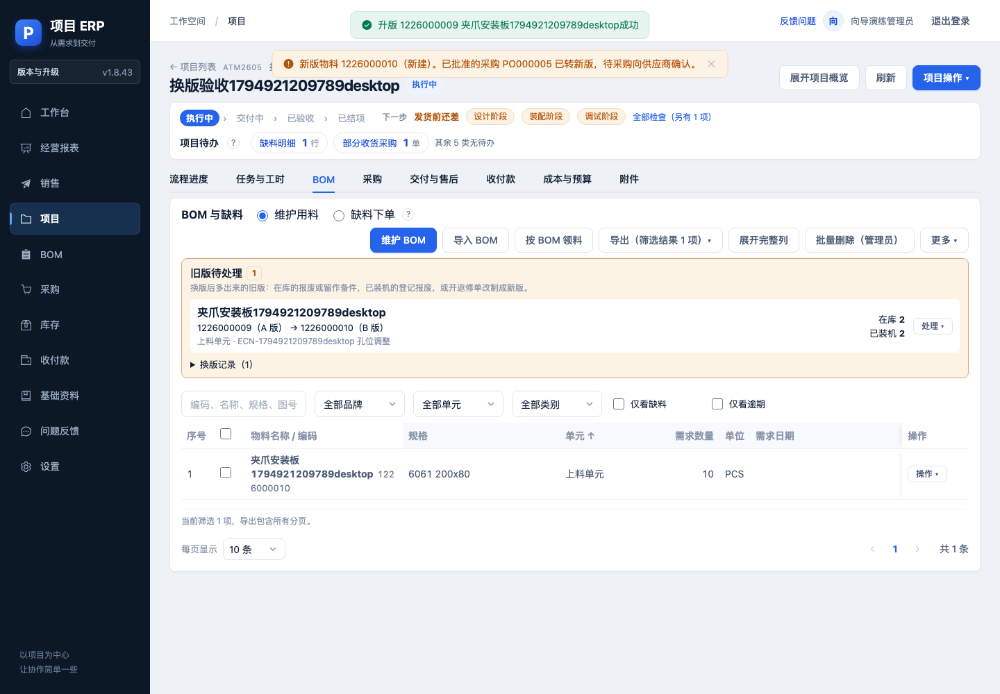
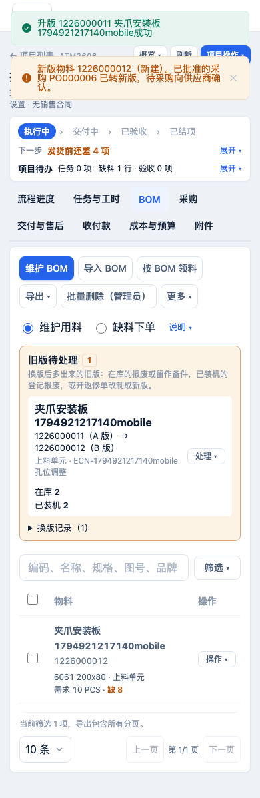

# v1.8.44

自动化行业的非标件经常要反复改图。本版把这件事做成一条完整流程：工程师一步升版；在途的采购自动按新图改单；多出来的旧版由仓管、工程师和采购分别处理，并在工作台提醒。新增数据库迁移 `business.0029_revision_change`。

## 本次更新

### 一步升版
- 项目 BOM 行「操作 → 升版」，只对有图号的物料显示。只需填新的图档版本和变更说明；名称、规格有变化时一并改。
- 同图号、同版本的物料已存在就直接使用，不存在就复制原物料资料（类别、品牌、单位等）自动建新编码。
- 同一物料还用在其他项目时，可以勾选一并换版。默认只改本项目，只能勾选自己能维护 BOM 的项目；不能维护的项目写在提示里，请对应负责人处理。
- 换成另一个型号仍用「替换物料」，与升版走同一套换版处理。

### 导入换版
- BOM 导入模板末列新增「替换原编码」：填本单元的旧版编码，本行物料编码填新版，就在原单元把旧版换成新版。变更说明必填。
- 同图号升版时，物料编码可以留空，只填新的「图档版本」，其余资料沿用旧版。
- 预览里换版行显示「换版」和原物料。旧的 15 列文件照常导入。

### 旧版已领用、有在途采购，不再拦住换版
以前旧版有在途采购或已领用时不能替换，要先手工取消采购、退料。现在换版时：
- 还没批准的采购单，直接把这一行改成新版。
- 已批准的采购单，取消旧版余量，在同一张单里新增新版明细，沿用原单价和交期，标为「待采购确认」。采购员在工作台「换版改单待确认」或采购单「确认换版改单」里处理：
  - 供应商能按新图做：「按新图改单」，报价变了可以改单价，应付同步调整；
  - 供应商不接受改图：「取消余量」，再按缺料重新下单。
- 采购确认前，仓库收货列表不列出这一行，避免把按旧图做的货当新版收进来。
- 已隔离待检的旧版不转，仍按隔离品流程处理。

### 旧版待处理
换版后，已到货或已领用、超出现 BOM 需求的旧版，列在项目 BOM 页上方的「旧版待处理」，同时进入工作台：
- 仓管：在库的旧版「在库报废」（出库，金额计入项目材料成本），或「留作备件」（不出库，不再算本项目的）。
- 仓管或工程师：已装在设备上的旧版拆下报废，用「已装机报废」登记数量。
- 采购员：能改制的「开返修单」，生成一张新版物料的返修采购草稿，照常提交审批和收货。在库旧版返修的，收到改好的新版时，同数量旧版自动出库。

其他：
- 「换版记录」列出每次换版的新旧编码与版本、单元、数量、在途转换数量、原因和经办人。
- 库存流水新增「旧版报废」「送修改制」两类；项目成本的材料成本包含这两类出库。





## 升级说明

- 新增数据库迁移 `business.0029_revision_change`：两张不可改的记录表（换版记录、旧版处理登记），采购明细加 3 个字段。升级时自动执行前向迁移，没有配置变化。
- `bom/{id}/replace/` 行为变化：不再因关联在途采购或已领用返回 409，改为转换在途并记入旧版待处理；返回值新增 `change`、`converted`。依赖原拦截的外部脚本需要更新。
- BOM 导入模板由 15 列变为 16 列，BOM 导出的「导入格式」相应多一列；旧的 15 列文件照常导入。
- 新接口：`bom/{id}/upgrade/`、`bom/{id}/upgrade-scope/`、`projects/{id}/obsolete-parts/`、`revision-changes/{id}/dispose/`、`revision-changes/{id}/rework/`、`purchases/{id}/revision-review/`。
- 工作台新增 `revision_reviews`、`obsolete_parts`；采购明细新增 `revision_role`、`revision_pending`、`revision_from`、`revision_from_name`；库存流水 `kind` 新增 `scrap`、`rework`；`demand/` 新增 `revision_changes`。
- 待采购确认的换版明细不能收货（返回 409），需先确认或取消。

## 验证

已完成：
- 后端新增 `test_bom_revision`（11 项）：
  - 未批准和已批准采购的在途转换，以及应付金额的增减；
  - 待审批修改申请时拒绝换版；
  - 新版数量下限；
  - 旧版待处理的在库、已装机计算；
  - 报废出库与留用；
  - 返修草稿，以及收货时旧版自动出库；
  - 采购确认、改价、取消；
  - 待确认明细拒收；
  - 升版建码与复用、跨项目换版与权限；
  - 导入「替换原编码」与留空升版。
- 后端完整运行 846 项。4 项失败，都是本版有意改变的行为：替换物料遇在途不再拦截、模板多一列、导入汇总多 `replace`。更新断言后，受影响模块重跑 84 项通过。并发阶段 44 项、checks 阶段（矩阵登记、Ruff、Django 检查、迁移检查）通过。
- 前端单元测试 738 项、ESLint、类型检查通过。新增用例覆盖：
  - 升版入口与跨项目勾选；
  - 换版结果提示；
  - 采购「确认换版改单」，收货排除待确认明细；
  - 旧版待处理面板：各岗位的处理入口；
  - 工作台两类新待办。
- 浏览器用例：
  - 新增 `bom-revision`：升版 → 在途转新版 → 在库旧版报废 → 待确认明细不能收 → 采购确认后可收。桌面端和手机端通过。
  - BOM、采购、库存相关的 11 个已有文件（23 项）在桌面端通过。
  - 换版记录时间首轮按 UTC 显示，已改为业务时区。

未完成：
- 受影响范围内其余浏览器用例、以及上述已有用例的手机端，本地没有运行，由 CI 按影响范围运行。
- 没有在有真实业务数据的正式服务器上验证升级迁移。

发布流程强制执行本版代码的发版验证，通过后才发布；不将其称为完整业务链验收。

## 📥 Installation

### Docker

下载下方对应平台的 `atm-erp-v1.8.44-<platform>-docker.zip`，解压并进入目录。仅需 Docker Engine / Docker Desktop（Linux 容器）与 Compose v2。包内 Compose 固定该版预构建多架构镜像摘要，不在本机构建。全新部署复制配置并填写随机密钥后启动：

```bash
# macOS / Linux
cp .env.example .env
chmod 600 .env
# 编辑 .env，填写数据库密码、SECRET_KEY 和管理员初始密码
docker compose up -d
```

```powershell
# Windows PowerShell
Copy-Item .env.example .env
# 编辑 .env 后
docker compose up -d
```

### Download (Linux · Docker)

在空目录下载并解压，再按上方步骤配置和启动；不要覆盖已有配置：

```bash
curl -fL https://github.com/hongheshan-svg/atm-erp/releases/download/v1.8.44/atm-erp-v1.8.44-linux-docker.zip -o atm-erp-v1.8.44-linux-docker.zip && unzip atm-erp-v1.8.44-linux-docker.zip
```

安装后默认访问 `http://127.0.0.1:8080/erp/`，用户名 `admin`，初始密码为 `.env` 的 `LEAN_ADMIN_PASSWORD`，首次向导要求修改。已有 `.env.lean` 的部署显式使用 `--env-file .env.lean`，不要新建配置替代。新版 Docker up 后默认接入容器内网页升级，无需宿主机执行器或 docker.sock；须保留 lean_runtime 卷。兼容范围、恢复及原生 Linux systemd 安装见 README。

### Manual download

从下方 **Assets** 下载适合平台的安装包：

- 平台：`macos` / `linux` / `windows`。
- 安装方式：`docker` / `native`；原生包包含预编译依赖，运行环境与安装步骤见 Installation Guide。
- SHA256 校验清单：`atm-erp-v1.8.44-SHA256SUMS.txt`。

## 📚 Documentation

- [GitHub Repository](https://github.com/hongheshan-svg/atm-erp)
- [Installation Guide](https://github.com/hongheshan-svg/atm-erp/blob/v1.8.44/README.md)
