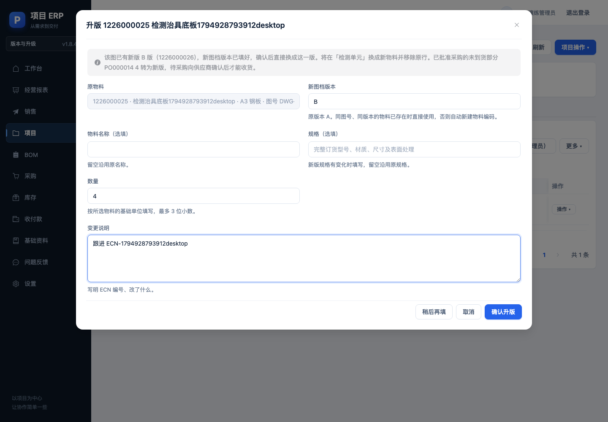
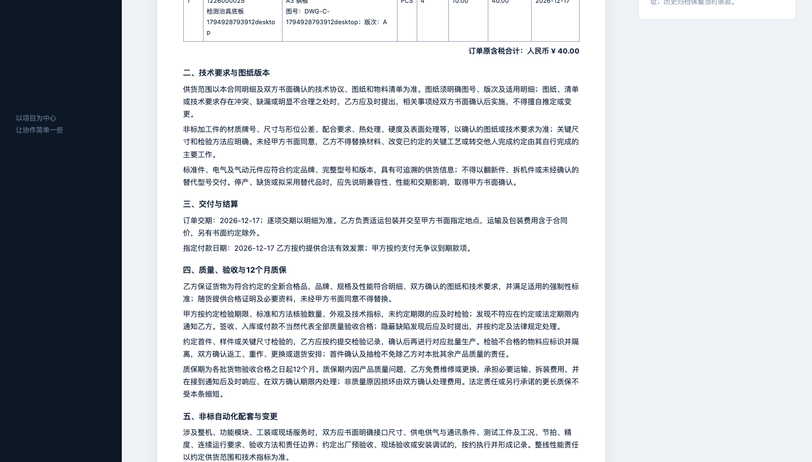
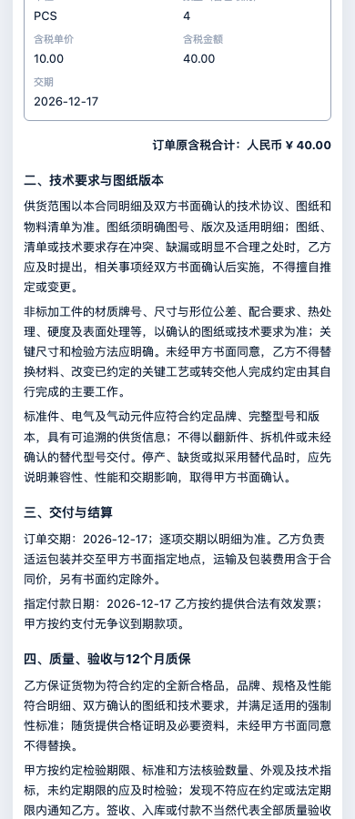

# v1.8.45

非标件换版第二阶段。上一版把一次换版做成了完整流程，本版针对同一张图反复修改：
- 旧版物料会标出「已有新版」，可以一键换成已有的新版；
- 换版前先看到会改哪些采购、旧版会剩多少；
- 合同已归档的采购按新图改单后，提醒与供应商重签。

没有数据库迁移。

## 本次更新

### 「该图已有新版」
同一张图在别的项目已经升到新版时，还在用旧版的地方都会标出来：
- 项目 BOM 行：标签「有新版 B」，「操作」里显示「升版（换成已有 B 版）」。点开后新图档版本已填好，确认后直接用已有的新版物料，不再重复建码。
- 物料下拉、BOM 导入预览：写明「该图已有新版 B 版（编码）」。导入不拦截，确认要用旧版可以照常导入；要换新版，预览里写了怎么填。
- 基础资料物料列表：图档版本一列写「A · 已有新版 B」，手机端同样显示。

判断规则：
- 只认同图号的换版。换成另一个型号，是那个项目自己的替代，不算旧版过时。
- 改回旧版的，以最近一次换版为准。
- 最新版本已停用时，退回最近一个在用版本。

### 物料的版本记录
基础资料「物料 → 操作 → 版本记录」（有图号的物料才有）：
- 列出同一图号的全部版本，以及哪个是当前最新；
- 列出你参与的项目里每次换版的时间、项目、单元、数量、改单数量和变更说明（ECN）。



### 换版前先看影响
「升版」「替换物料」对话框和 BOM 导入预览，在提交前写明：
- 哪些还没批准的采购单会直接改成新版；
- 哪些已批准采购的未到货部分会转为新版、等采购员确认。有待处理修改申请、会挡住换版的采购单会先点名。
- 换版后旧版已装机、在库各多少会进入「旧版待处理」；别的单元还要用旧版的，先留给它们。

升版时勾选「一并换版」的其他项目，也会写明各自的在途和已领数量。

### 合同已归档的改单提醒重签
- 采购员「确认换版改单」后，如果本单已经归档过签署合同，会提示与供应商确认新图和价格，签回后归档新版本。
- 工作台新增「换版待重签合同」，点进去就是采购合同页。
- 采购合同页上方逐条列出与已归档版本相比的变化：旧版数量变为 0、新增的新版明细和单价、改过的单价和交期。点「查看改单后的当前合同」核对，再「归档新版本」，提醒随即消失。





## 升级说明

- 没有数据库迁移和配置变化。
- 新接口：
  - `items/{id}/revisions/`（版本记录）；
  - `bom/{id}/revision-impact/`（换版影响预估）。
- 新增返回字段：
  - `items/` 列表、详情、`similar/` 和 `demand/` 每行：`newer_revision`。物料导出不含此列。
  - `upgrade-scope/`：`in_transit`、`issued`。
  - 导入预览：`newer_revision`、`revision_hint`、`replace_impact`。
  - `contract-preview/`：`latest_archived_version`、`changes_since_archive`。
  - `revision-review/`：`contract_version`。
- 工作台新增 `contract_updates`。
- 已归档的采购合同页：查看当前资料时，按钮显示「归档新版本」，状态文字写明最近归档的版本号。

## 验证

已完成：
- 后端 `test_bom_revision` 新增 12 项，共 23 项通过。新增用例覆盖：
  - 版本链：沿链取最新、最新版停用时退回、改回旧版、换型号不算过时、导出不含新版列；
  - 版本记录按参与项目过滤；
  - 换版影响与实际换版结果一致，别的单元仍需旧版时先留给它们；
  - 导入预览的新版提示与换版影响；
  - 确认改单返回合同版本；
  - 合同变化逐条列出；
  - 工作台「换版待重签合同」在重新归档后消失。
- 按影响范围运行后端 883 项：
  - 1 项失败：1000 行 BOM 的查询条数上限从 6 条到 7 条，多出的一条是版本链查询，不随行数增加。已改上限并写明原因，重跑通过。
  - 并发阶段 44 项、checks 阶段（矩阵登记、Ruff、Django 检查、迁移检查）通过。
- 前端单元测试全部通过，ESLint、类型检查通过。新增用例覆盖：
  - 新版提示与升版预填；
  - 影响说明文字；
  - 版本记录；
  - 合同变化提示条与切换到当前合同；
  - 确认改单的重签提示；
  - 工作台新待办。
- 浏览器用例：
  - `bom-revision` 新增一条：A 项目先升版 → B 项目旧版行标出新版、升版直接换成已有新版并写明在途影响 → 采购改价确认 → 工作台和合同页提示重签 → 物料版本记录。原有一条增加提交前影响说明的断言。两条在桌面端和手机端通过。
  - 采购合同归档用例在桌面端和手机端通过。
  - BOM、采购、导入、基础资料相关的已有用例在桌面端运行，结果见 PR。

未完成：
- 受影响范围内其余浏览器用例、以及已有用例的手机端，本地没有运行，由 CI 按影响范围运行。
- 没有在有真实业务数据的正式服务器上验证。

发布流程强制执行本版代码的发版验证，通过后才发布；不将其称为完整业务链验收。

## 📥 Installation

### Docker

下载下方对应平台的 `atm-erp-v1.8.45-<platform>-docker.zip`，解压并进入目录。仅需 Docker Engine / Docker Desktop（Linux 容器）与 Compose v2。包内 Compose 固定该版预构建多架构镜像摘要，不在本机构建。全新部署复制配置并填写随机密钥后启动：

```bash
# macOS / Linux
cp .env.example .env
chmod 600 .env
# 编辑 .env，填写数据库密码、SECRET_KEY 和管理员初始密码
docker compose up -d
```

```powershell
# Windows PowerShell
Copy-Item .env.example .env
# 编辑 .env 后
docker compose up -d
```

### Download (Linux · Docker)

在空目录下载并解压，再按上方步骤配置和启动；不要覆盖已有配置：

```bash
curl -fL https://github.com/hongheshan-svg/atm-erp/releases/download/v1.8.45/atm-erp-v1.8.45-linux-docker.zip -o atm-erp-v1.8.45-linux-docker.zip && unzip atm-erp-v1.8.45-linux-docker.zip
```

安装后默认访问 `http://127.0.0.1:8080/erp/`，用户名 `admin`，初始密码为 `.env` 的 `LEAN_ADMIN_PASSWORD`，首次向导要求修改。已有 `.env.lean` 的部署显式使用 `--env-file .env.lean`，不要新建配置替代。新版 Docker up 后默认接入容器内网页升级，无需宿主机执行器或 docker.sock；须保留 lean_runtime 卷。兼容范围、恢复及原生 Linux systemd 安装见 README。

### Manual download

从下方 **Assets** 下载适合平台的安装包：

- 平台：`macos` / `linux` / `windows`。
- 安装方式：`docker` / `native`；原生包包含预编译依赖，运行环境与安装步骤见 Installation Guide。
- SHA256 校验清单：`atm-erp-v1.8.45-SHA256SUMS.txt`。

## 📚 Documentation

- [GitHub Repository](https://github.com/hongheshan-svg/atm-erp)
- [Installation Guide](https://github.com/hongheshan-svg/atm-erp/blob/v1.8.45/README.md)
