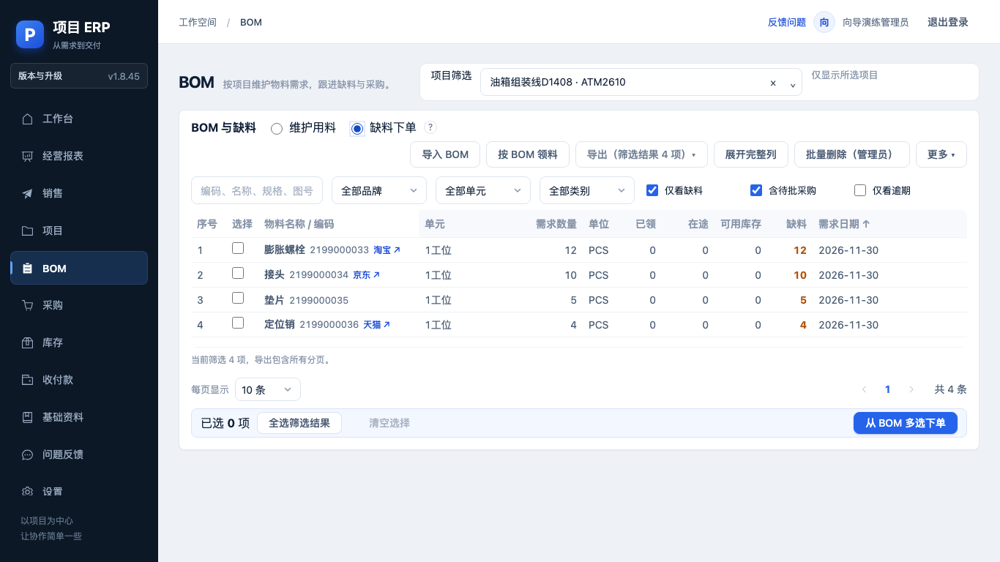
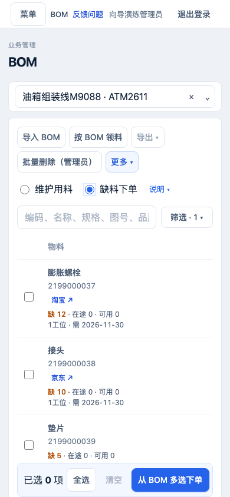
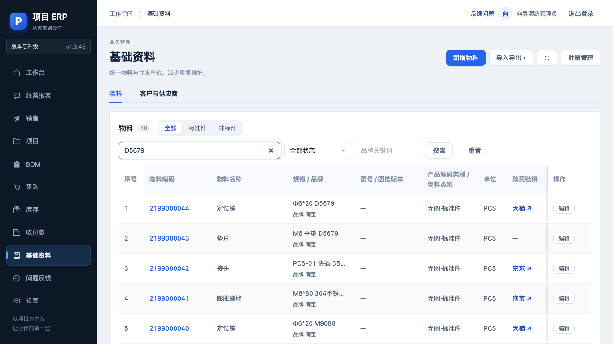

# v1.8.47

物料加「购买链接」。有同事反馈：淘宝等网上买的物料，在 BOM 缺料清单里没有淘宝链接，下单时还得再去搜。本版给物料加了一个购买链接：在基础资料里填，或者随 BOM、物料导入一起带进来；填了链接的物料，在 BOM 缺料、从 BOM 多选下单、采购明细和物料列表里都能直接点开商品页。

新增一个数据库迁移 `business.0030_item_purchase_url`（物料表加一列），升级时自动执行，没有配置变化。

## 本次更新

### 物料资料里填购买链接
「基础资料 → 物料」新增或编辑物料时，多了一项「购买链接」（选填）：
- 可以直接粘贴淘宝、京东 App 里「分享 → 复制链接」得到的整段文字，比如「【淘宝】假一赔四 https://m.tb.cn/h.xxx?tk=… 「商品名」点击链接直接打开」，系统只保存其中的链接。
- 填的内容里没有 http:// 或 https:// 开头的网址时，提示重新填写；不会存一段打不开的文字。
- 链接不参与查重，也不算物料身份：已经被 BOM、采购引用的物料，或已按类别编码的物料，都可以随时改链接或清空。

### 在哪里能点开
链接文字按网店写，比如「淘宝 ↗」「京东 ↗」「天猫 ↗」，认不出的网店写「购买链接 ↗」。点开在新标签页打开商品页。
- BOM「缺料下单」和「维护用料」：物料编码旁边；
- 采购页「从 BOM 多选下单」：选料表里物料名称旁边；
- 采购单「查看明细」：物料格最下面一行；
- 基础资料物料列表：新增「购买链接」一列。







### BOM 导入带链接
BOM 导入模板末尾加了一列「购买链接」（现在共 17 列），工程师 BOM 表里的链接可以一起导进来：
- 新物料：按表里的链接保存。
- 已有物料原来没有链接：补上，预览里写「已补填购买链接」。只补链接、用量没变的文件也能导入，比如用「导出 → 可回导模板」导出后只填链接列再导回。
- 已有物料已经有别的链接：不覆盖，预览里提示「已按系统为准」。要换链接请到基础资料改。
- 这一列填的不是网址（比如只写了「淘宝」或「见收藏夹」）：这一行照常导入，只是不保存链接，预览里写明原因，不会挡住整份 BOM。
- 之前下载的 15 列、16 列模板照常可以导入，按没有链接处理。

注意：导入读的是单元格里的文字。单元格里要直接是网址或分享文字；如果单元格只显示「链接」两个字、网址藏在超链接里，读不到网址。

### 物料导入与导出
- 物料导入模板末尾加「购买链接」列，规则同上；之前的物料模板照常接受。
- 物料导出、BOM 三种导出（BOM 明细、缺料清单、可回导模板）都带「购买链接」列。

## 升级说明

- 新增数据库迁移 `business.0030_item_purchase_url`：物料表加一列 `purchase_url`（最多 1000 字符，默认空），升级时自动执行前向迁移。已有物料的链接为空，不影响现有数据。
- 没有配置变化。
- 接口变化：
  - `items/` 新增、修改可传 `purchase_url`；列表和详情返回 `purchase_url`。
  - `bom/`、`projects/{id}/demand/` 每行、采购明细 `lines[]` 新增只读 `purchase_url`。
  - BOM 导入模板 17 列（末列「购买链接」），兼容旧的 3/4/7/15/16 列模板。物料导入模板 11 列（末列「购买链接」），兼容旧模板。

## 验证

已完成：
- 后端全部 906 项测试通过（含新增 4 项）；checks 阶段（矩阵登记、Ruff、Django 检查、迁移检查）通过。新增用例覆盖：
  - 粘贴分享文字只存链接；不是网址、`javascript:`、超长链接被拒绝；已引用、已编码的物料可改链接、可清空；
  - BOM 导入：已有物料补填链接、已有链接不覆盖、新物料带链接、无效链接不挡导入；只补链接不改用量的文件可以导入；预览不改主数据；
  - 15、16 列旧模板照常导入；
  - BOM 行、可回导模板导出、物料导入都带链接。
- 原有一项 BOM 模板用例的列范围随模板加一列更新（P 列改为 Q 列）。
- 前端单元测试 87 个文件、748 项全部通过，ESLint、类型检查通过。新增用例覆盖：只把 http(s) 链接渲染成链接、按网店域名写链接文字、BOM 缺料页链接（新标签页打开、`javascript:` 不渲染）、物料表单和列表、采购明细链接。
- 浏览器用例（本地开发服务器）：
  - `bom-purchase-layout` 新增断言：建料时粘贴淘宝分享文字只存链接，从 BOM 多选下单的选料表里显示「淘宝 ↗」并在新标签页打开。桌面端和手机端通过。
  - `transfers` 的物料模板表头随新列更新，桌面端和手机端通过。
  - BOM 导入、导出、换版、选料、导入入口、采购合同等 8 个相关文件（18 项）在桌面端通过；其中两处用旧 10 列物料模板导入，也验证了旧模板兼容。

未完成：
- 受影响范围内其余浏览器用例、以及已有用例的手机端，本地没有运行，由 CI 按影响范围运行。
- 没有在有真实业务数据的正式服务器上验证。

发布流程强制执行本版代码的发版验证，通过后才发布；不将其称为完整业务链验收。

## 📥 Installation

### Docker

下载下方对应平台的 `atm-erp-v1.8.47-<platform>-docker.zip`，解压并进入目录。仅需 Docker Engine / Docker Desktop（Linux 容器）与 Compose v2。包内 Compose 固定该版预构建多架构镜像摘要，不在本机构建。全新部署复制配置并填写随机密钥后启动：

```bash
# macOS / Linux
cp .env.example .env
chmod 600 .env
# 编辑 .env，填写数据库密码、SECRET_KEY 和管理员初始密码
docker compose up -d
```

```powershell
# Windows PowerShell
Copy-Item .env.example .env
# 编辑 .env 后
docker compose up -d
```

### Download (Linux · Docker)

在空目录下载并解压，再按上方步骤配置和启动；不要覆盖已有配置：

```bash
curl -fL https://github.com/hongheshan-svg/atm-erp/releases/download/v1.8.47/atm-erp-v1.8.47-linux-docker.zip -o atm-erp-v1.8.47-linux-docker.zip && unzip atm-erp-v1.8.47-linux-docker.zip
```

安装后默认访问 `http://127.0.0.1:8080/erp/`，用户名 `admin`，初始密码为 `.env` 的 `LEAN_ADMIN_PASSWORD`，首次向导要求修改。已有 `.env.lean` 的部署显式使用 `--env-file .env.lean`，不要新建配置替代。新版 Docker up 后默认接入容器内网页升级，无需宿主机执行器或 docker.sock；须保留 lean_runtime 卷。兼容范围、恢复及原生 Linux systemd 安装见 README。

### Manual download

从下方 **Assets** 下载适合平台的安装包：

- 平台：`macos` / `linux` / `windows`。
- 安装方式：`docker` / `native`；原生包包含预编译依赖，运行环境与安装步骤见 Installation Guide。
- SHA256 校验清单：`atm-erp-v1.8.47-SHA256SUMS.txt`。

## 📚 Documentation

- [GitHub Repository](https://github.com/hongheshan-svg/atm-erp)
- [Installation Guide](https://github.com/hongheshan-svg/atm-erp/blob/v1.8.47/README.md)
