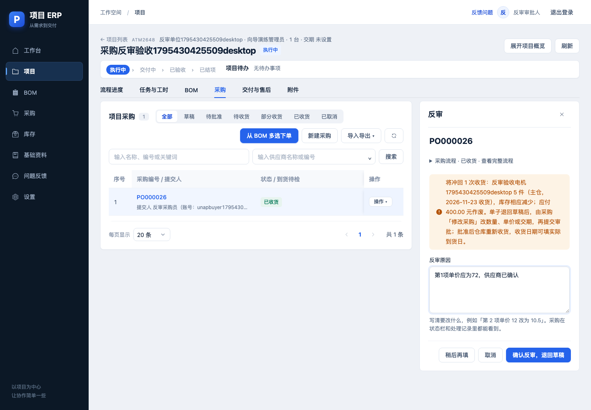
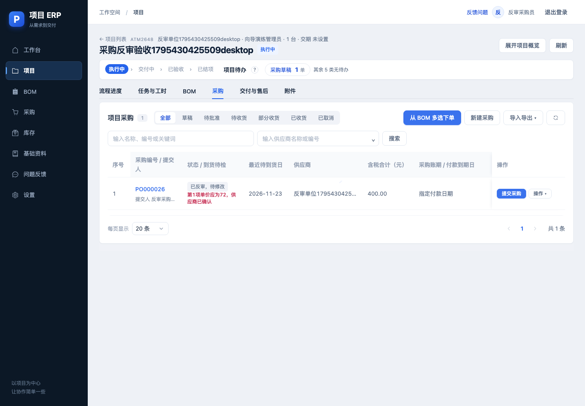
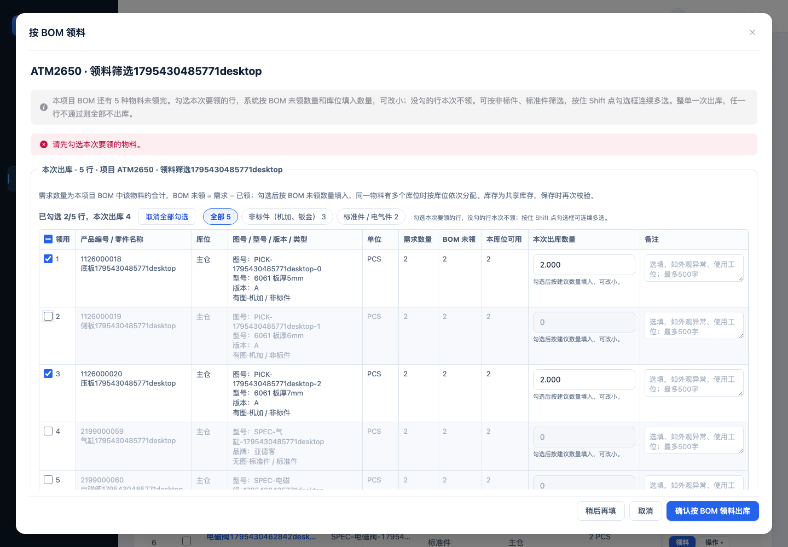

# v1.8.48

这一版处理几条使用反馈：采购单批准、收货后发现填错没法改；采购列表看不出是谁提交的、哪张被退回了、为什么退回；BOM 里查不到物料入库日期；BOM 导入填了物料编码却导不进去、只能自动编码；按 BOM 领料几百行物料混在一起，只领几项也要把其余的逐个改成 0。

新增一个数据库迁移 `business.0031_stockmove_receipt_reversal`（库存流水类型加一项「反审冲回」，只改选项，不改表结构），升级时自动执行，没有配置变化。

## 本次更新

### 采购单「反审」：批准后发现填错，退回草稿重新改
采购列表该单「操作 → 更正与撤销 → 反审」。待收货、部分收货、已收货的采购单都可以反审，有权批准这张采购的人（经理、采购主管）来操作；本单申请人不能反审自己的单子（与批准同一规则），管理员例外但须写原因。
- 打开时先写清会发生什么：要冲回哪几次收货（物料、数量、库位、收货日期）、作废多少应付；本单归档过采购合同的，提醒改单后与供应商重签。
- 填「反审原因」（写清要改什么）后确认：已收的货按收货数量从库存冲回，库存流水记「反审冲回」；应付作废；冲回的成本差与采购退货一样计入本项目成本（成本明细里的「采购退货与反审价差」）。
- 单子回到草稿，采购用「修改采购」改数量、单价、交期后重新提交；批准后重新生成应付，仓库重新收货，收货日期可以填实际到货那天。
- 下列情况先拦下，并逐条写明先做什么：已付款或有供应商退款、已有对账单、有到货在隔离待检、已办理采购退货或登记了采购质保、含换版改单明细，以及到货已被领用（库存不够冲回，或冲回后会占用其他项目已到货的物料，请先退料）。
- 冲回过的收货批次不能再办理采购退货或登记质保；处理记录里有「反审（退回草稿）」一条。



### 采购列表：谁提交的、哪张被退回、为什么
- 「采购编号」下面写提交人；还没提交过的草稿写创建人。
- 被「退回修改」、同意修改申请或反审回到草稿的单子，状态写「已退回，待修改」「已反审，待修改」，下面红字写退回原因；鼠标悬停看谁、什么时候、哪种退回和完整原因。重新提交后提示自动消失。
- 提交人的工作台会把被退回的采购草稿排进「今天要处理的」。
- 采购导出多了「提交人」「退回方式」「退回说明」「退回原因」列。



### BOM 看物料入库日期
项目 BOM 页点「展开完整列」，多了「本项目最近入库」一列：本项目采购最近一次合格入库的日期，没有到货写「—」，反审冲回的不算。手机上写在每行摘要里。BOM「缺料清单」导出也带这一列。

### BOM 导入：表里的编码系统里没有，按图号用系统已有物料
常见情况：表里沿用了自己的旧编号，这个编码系统里没有，而同图号、同版本的物料系统里早已有了另一个编码。以前这一行会报「此图号及版本已由其他物料使用」，只能清空编码让系统自动编码。现在：
- 名称一致：直接按系统里的编码使用，预览写明「表中编码 X 系统里没有；同图号同版本的物料是 Y，已按系统编码使用」，可以直接确认导入，不会多建物料。
- 名称不同（多半是图号填错）：仍然拦下，但直接写出系统里的编码和名称，请核对图号或把编码改成系统编码。
- 在基础资料新建物料碰到图号版本冲突时，提示里也写出占用它的物料编码和名称。

### 按 BOM 领料：按类别筛开，勾选要领的行
- 每行前面有勾选框，默认都不勾；勾上的行按 BOM 未领数量和库位填入数量（可改小），没勾的行本次不领，不用再逐行清零。
- 上方可按「非标件（机加、钣金）」「标准件 / 电气件」筛开，按钮上写着每类有几行；全选只勾当前筛出来的行。
- 按住 Shift 先后点两行的勾选框，中间的行一起勾上（或一起取消）。
- 勾了但把数量清成 0 的行，提交时指出是哪一行。



## 升级说明

- 新增数据库迁移 `business.0031_stockmove_receipt_reversal`：库存流水类型加「反审冲回」（`receipt_reversal`），只改选项不改表结构，升级时自动执行前向迁移，不改动已有数据。
- 没有配置变化。
- 接口变化：
  - 新增 `purchases/{id}/unapprove-check/`（GET，反审预览）和 `purchases/{id}/unapprove/`（POST `{reason}`，需 Idempotency-Key）。
  - 采购列表和详情新增只读 `created_by_name`、`submitted_by_name`、`returned_action`、`returned_note`、`returned_reason`。
  - `moves/` 每行新增只读 `reversed`（该收货已被反审冲回）。
  - `projects/{id}/demand/` 每行新增只读 `last_received_date`；BOM 缺料清单导出加「本项目最近入库」列。
  - BOM 导入：填写的编码系统里没有、同图号同版本已有物料时，名称一致按该物料使用（`material_action` 为「按图号使用已有物料」），名称不同或该物料已停用为行错误。
  - 按 BOM 领料接口不变；前端只提交勾选且数量大于 0 的行。

## 验证

已完成：
- 后端全部 915 项测试通过（含新增 9 项）；checks 阶段（矩阵登记、Ruff、Django 检查、迁移检查）通过。新增用例覆盖：
  - 反审：已收货采购退回草稿，库存、应付、明细同时冲回，重新批准沿用原应付；未收货的只退回草稿；付款、对账、隔离待检、采购退货、换版明细、到货已被领用或冲回会占用其他项目到货时逐条拦下且不改数据；申请人不能反审本人采购，管理员须写原因；反审与采购退货并发只有一个成功；冲回的批次不能再退货、不能登记质保，不再算入库日期。
  - 采购列表的提交人、退回方式和原因（退回修改、同意修改申请、反审；重新提交后清空）。
  - BOM 最近入库日期（页面与导出一致）。
  - BOM 导入：编码系统里没有、同图号同版本已有物料时按系统编码使用；名称不同、物料已停用时拦下并写出系统编码。
- 原有一项「千行 BOM 查询条数」用例的上限由 7 调为 8（新增一条按物料分组的入库日期汇总，与行数无关）。
- 前端单元测试 87 个文件、752 项全部通过，ESLint、类型检查通过。新增用例覆盖反审入口与对话框、退回原因显示、BOM 入库日期列、按 BOM 领料的类别筛选、勾选、Shift 连选和提交。
- 浏览器用例（本地开发服务器，桌面端和手机端）：
  - `purchase-changes` 新增「采购反审」：审批人反审已收货采购，采购在列表看到提交人和退回原因，改单后重新批准收货。通过。
  - `warehouse-lines` 新增「按 BOM 领料」：按类别筛选、默认不勾时提交被提示、Shift 连选、只领勾选的行。通过。
  - 两个文件里原有的用例同时通过；`review-remediation`、`bom-export`、`bom-purchase-layout`、`bom-selection`、`import-feedback` 在桌面端通过。`product-coding` 的空编码导入用例在本地预览库上因前几次运行留下的同型号物料被复用而失败（与本版改动无关），由 CI 在干净数据库上运行。

未完成：
- 受影响范围内其余浏览器用例、以及上述回归用例的手机端，本地没有运行，由 CI 按影响范围运行。
- 没有在有真实业务数据的正式服务器上验证。

发布流程强制执行本版代码的发版验证，通过后才发布；不将其称为完整业务链验收。

## 📥 Installation

### Docker

下载下方对应平台的 `atm-erp-v1.8.48-<platform>-docker.zip`，解压并进入目录。仅需 Docker Engine / Docker Desktop（Linux 容器）与 Compose v2。包内 Compose 固定该版预构建多架构镜像摘要，不在本机构建。全新部署复制配置并填写随机密钥后启动：

```bash
# macOS / Linux
cp .env.example .env
chmod 600 .env
# 编辑 .env，填写数据库密码、SECRET_KEY 和管理员初始密码
docker compose up -d
```

```powershell
# Windows PowerShell
Copy-Item .env.example .env
# 编辑 .env 后
docker compose up -d
```

### Download (Linux · Docker)

在空目录下载并解压，再按上方步骤配置和启动；不要覆盖已有配置：

```bash
curl -fL https://github.com/hongheshan-svg/atm-erp/releases/download/v1.8.48/atm-erp-v1.8.48-linux-docker.zip -o atm-erp-v1.8.48-linux-docker.zip && unzip atm-erp-v1.8.48-linux-docker.zip
```

安装后默认访问 `http://127.0.0.1:8080/erp/`，用户名 `admin`，初始密码为 `.env` 的 `LEAN_ADMIN_PASSWORD`，首次向导要求修改。已有 `.env.lean` 的部署显式使用 `--env-file .env.lean`，不要新建配置替代。新版 Docker up 后默认接入容器内网页升级，无需宿主机执行器或 docker.sock；须保留 lean_runtime 卷。兼容范围、恢复及原生 Linux systemd 安装见 README。

### Manual download

从下方 **Assets** 下载适合平台的安装包：

- 平台：`macos` / `linux` / `windows`。
- 安装方式：`docker` / `native`；原生包包含预编译依赖，运行环境与安装步骤见 Installation Guide。
- SHA256 校验清单：`atm-erp-v1.8.48-SHA256SUMS.txt`。

## 📚 Documentation

- [GitHub Repository](https://github.com/hongheshan-svg/atm-erp)
- [Installation Guide](https://github.com/hongheshan-svg/atm-erp/blob/v1.8.48/README.md)
