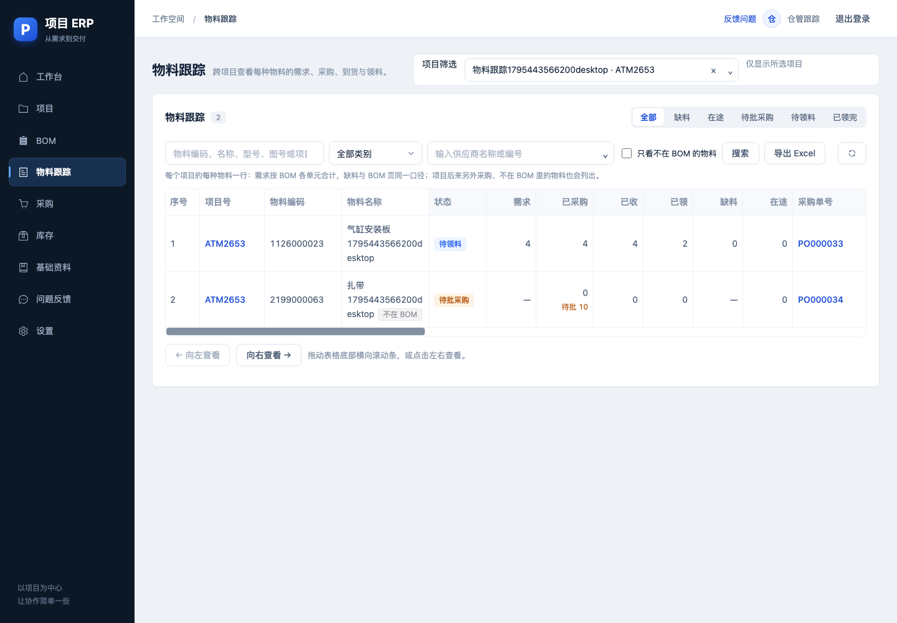

# v1.8.49

这一版回应两条使用反馈：想像物料跟踪 Excel 那样，一眼看到整个系统所有物料的需求、采购、到货和领料情况；领料单只记办理出库的仓管，记不下实际来领料的人。

新增一个数据库迁移 `business.0032_issueslip_recipient`（领料单加「领料人」一列，历史领料单留空），升级时自动执行，没有配置变化。

## 本次更新

### 新页面「物料跟踪」：跨项目一张表看全部物料
左侧导航「物料跟踪」（能看 BOM 的岗位都有）。每个项目的每种物料一行：
- **一行看清**：需求（BOM 各单元合计）、已采购（另写「待批 N」）、已收、已领、缺料、在途，再往右是采购单号、供应商、单价、金额、采购交期、最近入库日期、送货单号 / 收货说明、采购员、最近领料日期、领料人、领料单号，以及图号 / 版本、型号 / 规格、单位、类别、单元、需求日期、申请日期、申请人、备注。
- 同一物料分几次采购时，采购单号、供应商、交期并列写在格子里；单价不同写「多个」，悬停看全部价格。缺料与 BOM 页同一口径。
- **不在 BOM 的物料也列出**：项目后来另外采购（零星采购、补料）或领用、但不在当前 BOM 里的物料——包括改版时从 BOM 移除但已买或已领的——同样各占一行，标「不在 BOM」，需求和缺料写「—」。可勾「只看不在 BOM 的物料」单独查看。
- **状态**：缺料、在途、待批采购、待领料、已领完，上方一键筛选；另可按物料类别、供应商、关键词（物料编码、名称、型号、图号、项目）筛选。
- **范围**：选了项目只看该项目；不选时看需求中到交付中的项目，勾「包括已验收、已结项项目」看全部。只看到自己参与的项目（全局岗位看全部）。
- 项目号点开该项目 BOM，采购单号点开采购明细，领料单号点开可打印的领料单。「导出 Excel」按当前筛选导出全部行。
- 采购单号、供应商、采购员、送货单号只给能看采购单的岗位；单价、金额只给能看采购价的岗位；其他人看需求、数量、交期和领料情况。手机上每种物料一张卡片。



### 领料时记下「领料人」
单行领料、库存页勾选批量领料、按 BOM 领料的对话框都多了「领料人」（选填）：填实际来仓库领料的人，如「装配班 张师傅」，不需要有系统账号。领料人印在领料单单头，领料单列表多一列并可按领料人搜索，库存流水和物料跟踪表也能看到。经办仓管仍由系统自动记录。

## 升级说明
- 升级会执行数据库迁移 `business.0032_issueslip_recipient`，只给领料单加一列，耗时很短。
- 本版之前的领料单没有领料人，物料跟踪表里显示「—」。

## 📥 Installation

### Docker

下载下方对应平台的 `atm-erp-v1.8.49-<platform>-docker.zip`，解压并进入目录。仅需 Docker Engine / Docker Desktop（Linux 容器）与 Compose v2。包内 Compose 固定该版预构建多架构镜像摘要，不在本机构建。全新部署复制配置并填写随机密钥后启动：

```bash
# macOS / Linux
cp .env.example .env
chmod 600 .env
# 编辑 .env，填写数据库密码、SECRET_KEY 和管理员初始密码
docker compose up -d
```

```powershell
# Windows PowerShell
Copy-Item .env.example .env
# 编辑 .env 后
docker compose up -d
```

### Download (Linux · Docker)

在空目录下载并解压，再按上方步骤配置和启动；不要覆盖已有配置：

```bash
curl -fL https://github.com/hongheshan-svg/atm-erp/releases/download/v1.8.49/atm-erp-v1.8.49-linux-docker.zip -o atm-erp-v1.8.49-linux-docker.zip && unzip atm-erp-v1.8.49-linux-docker.zip
```

安装后默认访问 `http://127.0.0.1:8080/erp/`，用户名 `admin`，初始密码为 `.env` 的 `LEAN_ADMIN_PASSWORD`，首次向导要求修改。已有 `.env.lean` 的部署显式使用 `--env-file .env.lean`，不要新建配置替代。新版 Docker up 后默认接入容器内网页升级，无需宿主机执行器或 docker.sock；须保留 lean_runtime 卷。兼容范围、恢复及原生 Linux systemd 安装见 README。

### Manual download

从下方 **Assets** 下载适合平台的安装包：

- 平台：`macos` / `linux` / `windows`。
- 安装方式：`docker` / `native`；原生包包含预编译依赖，运行环境与安装步骤见 Installation Guide。
- SHA256 校验清单：`atm-erp-v1.8.49-SHA256SUMS.txt`。

## 📚 Documentation

- [GitHub Repository](https://github.com/hongheshan-svg/atm-erp)
- [Installation Guide](https://github.com/hongheshan-svg/atm-erp/blob/v1.8.49/README.md)
